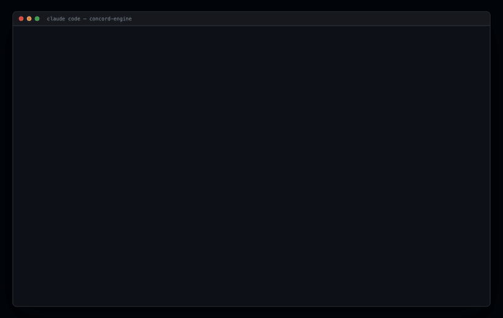

# orchestraguard

**Agent orchestration never drifts.**

Parallel agents don't scale past the human in the middle.

You run five agents to go faster. Four of them are right. The product is broken,
and the only thing that catches it is you — reading everything, holding the
whole picture, re-explaining decisions that were already made.

That's not a prompting problem. Your agents have **memory** and they have
**verification**, and neither one answers the question that actually breaks a
parallel run:

> Did these two agents just decide incompatible things?

orchestraguard answers it, and refuses the second decision.

[](https://github.com/harsh-chandak/orchestraguard/blob/main/assets/brag.mp4)

## The failure it stops

Your backend lead decides the identifier is `user_id`. Your frontend lead,
working in parallel, decides `userId`.

Both are defensible. Both sets of workers implement them faithfully. Both pass
their own tests. Nothing is red. You find out at integration — because *you*
noticed.

```
● frontend-lead · record_decision
    naming: User Identifier in API Payloads = userId

    ✗ REFUSED — contradicts a decision already in force
        existing   user_id   backend-lead (lead)
                   "matches the users table column"
        resolve by pm
```

The agent is stopped at the moment it tries to disagree. Not at integration.
Not by you.

## Why this isn't another memory tool

| Tool | Answers | Doesn't answer |
| --- | --- | --- |
| Handoff / memory tools | "what did the last agent know?" | "do these two agree?" |
| Orchestrator verification | "did this worker do its task?" | "do these two agree?" |
| Edit-conflict detection | "did two agents touch one file?" | "do these two agree?" |

And the obvious way to answer it — store decisions as prose, ask a model whether
two of them conflict — is slow, costs a call per check, and is wrong often
enough that people stop trusting it. A coordination layer nobody trusts is
worse than none, because it adds latency and false alarms to a workflow that
had neither.

**orchestraguard decides agreement by comparison, never by a model.** Decisions are
typed and narrow, so a contradiction is a comparison: same subject, different
value. No API call exists anywhere in the decision path — there's a test that
fails if one appears.

## Install

```bash
claude plugin marketplace add harsh-chandak/shadowjoin
claude plugin install orchestraguard@harsh-chandak
```

<sub>The `harsh-chandak` marketplace is hosted in the shadowjoin repo and carries
both tools — that first line is not a typo.</sub>

Or without Claude Code:

```bash
npx orchestraguard --help
```

## Use

Leads and the PM decide. **Workers write code and decide nothing.**

```bash
orchestraguard decide --kind naming \
  --subject "user identifier in API payloads" \
  --value user_id --as backend-lead \
  --rationale "matches the users table column"

orchestraguard check     # exits 1 if anything contradicts
orchestraguard verify    # are the decided routes actually served?
orchestraguard report    # how often did a conflict reach you?
```

Five kinds, each with its own comparison rule:

| kind | value | compared by |
| --- | --- | --- |
| `naming` | `"user_id"` | exact |
| `convention` | `"snake_case in payloads"` | exact |
| `api-contract` | `{"method":"POST","path":"/orders","status":201}` | structurally, ignoring trailing slashes and param naming |
| `enum` | `["pending","paid","shipped"]` | set equality |
| `schema` | `{"field":"id","type":"uuid","nullable":false}` | structurally |

## Who resolves what

```
worker vs worker   ->  team lead
lead   vs lead     ->  PM
PM can't resolve   ->  you
```

Adjudication is read off the hierarchy, not judged. A PM decision overrides a
lead's — that's an override, not a conflict. Two leads who disagree go to the
PM. Two PMs who disagree reach you, because nothing outranks them.

Two attempts at a layer, then it escalates. What reaches you is a packet — both
positions, who holds each, why, and what has already been tried:

```
CONFLICT c-01fc0217  naming: user identifier in API payloads
    backend-lead (lead)   user_id  "matches the users table column"
    frontend-lead (lead)  userId   "matches the TypeScript style guide"

    tried: proposed user_id; frontend-lead rejected, 3 call sites already public
    tried: proposed an alias field; rejected as duplication
    owner: you
```

Not "something went wrong, go read the logs."

## The number that matters

```
$ orchestraguard report

  47 conflicts recorded
    settled without you     44
    reached the PM          11
    reached you              3   6.4%
```

Every other orchestrator reports agents launched, tokens spent, tasks
completed. None of them reports whether the system handled itself — which is
the only number that says whether running ten agents actually cost you less
than running one.

## Honest limits

- **Only what's recorded is checked.** A lead who decides something in prose and
  never records it is invisible to this.
- **Subjects are matched loosely** — case, punctuation and accents are
  normalised, so "User Identifier" and "user identifier" collide. Two leads who
  describe the same thing in genuinely different words still won't. That's a
  real miss.
- **`verify` reads literal paths only.** A router mounted under a prefix, or a
  path built at runtime, is invisible to static extraction. It under-reports
  rather than accusing falsely, and prints how many files it read so the number
  isn't mistaken for completeness.
- **It doesn't verify the work was done.** That's your orchestrator's job.
- **It doesn't judge which decision is better.** It reports that two can't both
  hold, and who gets to rule.
- **Five kinds, deliberately.** `dependency` is deferred until semver range
  intersection is implemented properly; a comparator that calls `^1.0.0` and
  `^1.2.0` incompatible would be worse than not having it.

## License

MIT © Harsh N. Chandak
